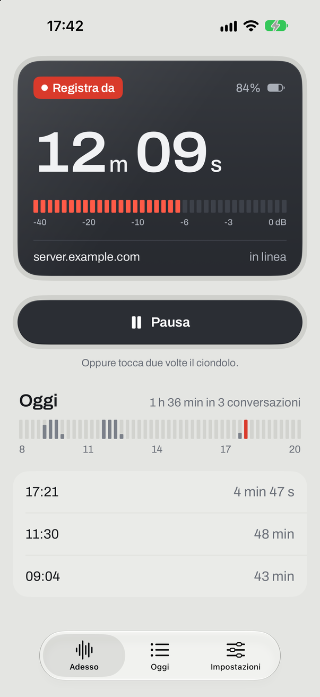
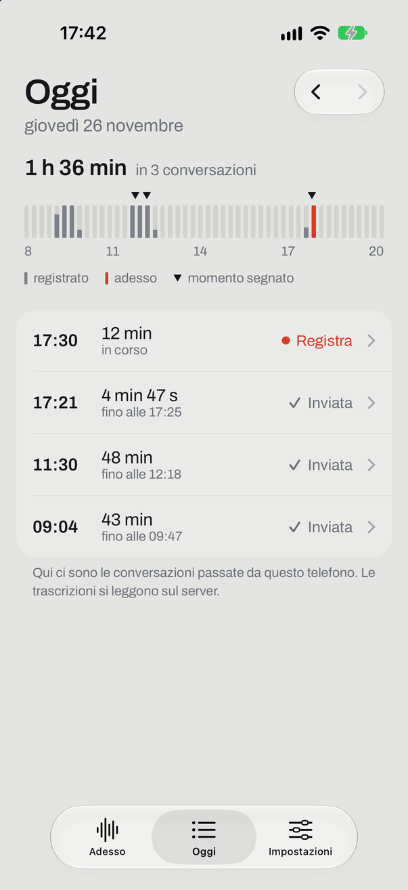
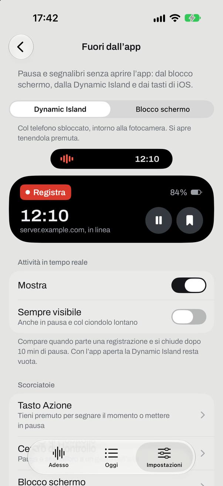

# pendant

[English](README.md) · **Italiano**

Un'app iOS per il ciondolo Omi CV1 che manda quello che sente al tuo server, invece che al cloud
di Omi.

<p>
  
  
  
</p>

## Perché

Il ciondolo Omi è un buon microfono da indossare, ma la sua app manda ogni conversazione al
cloud di Omi. pendant sostituisce quell'app: parla col ciondolo via Bluetooth, decodifica
l'audio sul telefono e lo manda su un WebSocket a un server scelto da te, dove viene conservato
e trascritto. Il telefono tiene l'audio solo finché manca la rete.

- Registra solo quando lo chiedi: ogni collegamento parte in pausa, un doppio tocco sul
  ciondolo apre e chiude una conversazione, un tocco singolo segna un momento.
- Pausa, ripresa e segnalibri anche dal tasto Azione, dal Centro di Controllo, dal blocco
  schermo e da un'attività in tempo reale nella Dynamic Island.
- Un avviso quando il ciondolo è acceso senza registrare, perché così consuma batteria.
- Temi per il display del registratore, in chiaro e in scuro.

L'interfaccia è in italiano.

## Requisiti

- Un ciondolo Omi CV1 col firmware 3.0.21, dimenticato nell'app Omi (iOS condivide un ciondolo
  fra le app, e anche l'app Omi riceverebbe l'audio).
- Un iPhone con iOS 26 e un Mac con Xcode; basta un account Apple gratuito, ma allora l'app
  scade dopo 7 giorni.
- Un server che parli il protocollo descritto nel [contratto col server](docs/ARCHITECTURE.md#server-contract):
  frame PCM su un WebSocket con un token, `CloseStream` per chiudere una conversazione. Chi
  mantiene il progetto lo fa girare su Nexus, una piattaforma dati personale.

## Installazione

Da `app/`:

```sh
brew install xcodegen
make run          # la prima volta crea Local.xcconfig e si ferma
# imposta DEVELOPMENT_TEAM in Local.xcconfig, poi
make run          # genera il progetto, compila, installa e avvia sull'iPhone collegato
```

Il Team ID è l'OU del certificato "Apple Development" nel portachiavi. Il primo avvio guida
fra Bluetooth, abbinamento del ciondolo, indirizzo e token del server, notifiche.

Gli altri comandi: `make help`. Senza iPhone, `make sim SCENE=home.rec` apre l'app nel
simulatore su una scena demo (`SIMULATOR=<nome>` sceglie il simulatore), e `make test` lancia i
test della logica.

## Stato

In uso ogni giorno da novembre 2026 (milestone M7); il prossimo passo è lo stato del ciondolo
mandato al server (M8). Vedi la [roadmap](docs/ROADMAP.md).

## Documentazione

- [Architettura](docs/ARCHITECTURE.md)
- [Decisioni](docs/DECISIONS.md)
- [Convenzioni](docs/CONVENTIONS.md)
- [Roadmap](docs/ROADMAP.md)
- [Ciondolo fai-da-te archiviato](docs/archive/ARCHITECTURE-diy.md), in italiano: il progetto
  su ESP32-S3 che questo ha sostituito

## Licenza

MIT, vedi [LICENSE](LICENSE). Il carattere Archivo resta con la SIL Open Font License, e il
protocollo Bluetooth di Omi è riconosciuto a Based Hardware con la loro licenza MIT.
