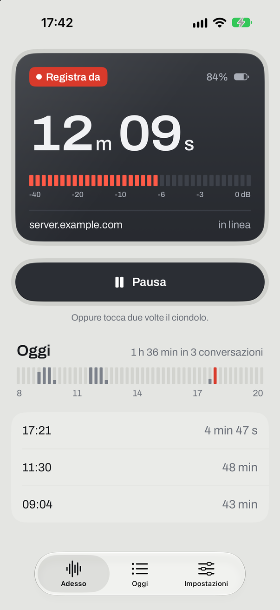
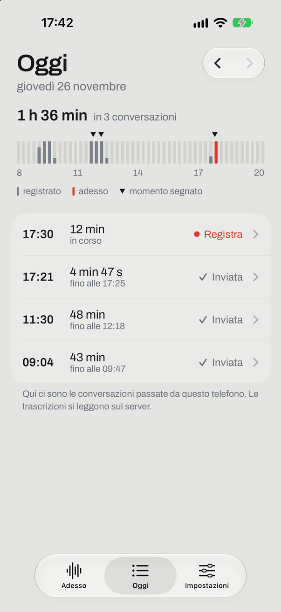
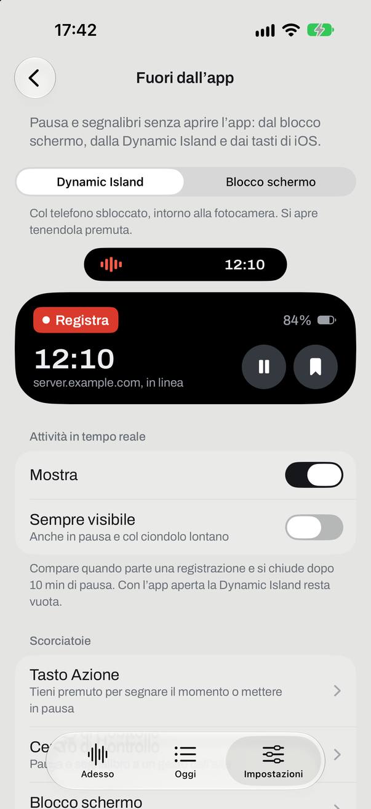

# pendant

**English** · [Italiano](README.it.md)

An iOS app for the Omi CV1 pendant that streams what it hears to your own server instead of the
Omi cloud.

<p>
  
  
  
</p>

## Why

The Omi pendant is a good microphone to wear, but its app sends every conversation to Omi's
cloud. pendant replaces that app: it talks to the pendant over Bluetooth, decodes the audio on
the phone and sends it over a WebSocket to a server you choose, where it is kept and
transcribed. The phone keeps audio only while the network is down.

- Recording only on request: every connection starts paused, a double tap on the pendant
  starts and stops a conversation, a single tap marks a moment.
- Pause, resume and bookmarks also from the Action button, Control Center, the lock screen and
  a Live Activity in the Dynamic Island.
- A warning when the pendant is on without recording, since that drains its battery.
- Themes for the recorder display, light and dark.

The interface is in Italian.

## Requirements

- An Omi CV1 pendant on firmware 3.0.21, forgotten in the Omi app (iOS shares a pendant
  between apps, and the Omi app would get the audio too).
- An iPhone on iOS 26 and a Mac with Xcode; a free Apple account is enough, but the app then
  expires after 7 days.
- A server that speaks the protocol in [the server contract](docs/ARCHITECTURE.md#server-contract):
  PCM frames over a WebSocket with a token, `CloseStream` to end a conversation. The maintainer
  runs it on Nexus, a personal data platform.

## Install

From `app/`:

```sh
brew install xcodegen
make run          # the first time it creates Local.xcconfig and stops
# set DEVELOPMENT_TEAM in Local.xcconfig, then
make run          # generate the project, build, install and launch on the connected iPhone
```

The Team ID is the OU of the "Apple Development" certificate in the keychain. The first launch
walks through Bluetooth, pairing the pendant, the server address and token, and notifications.

Other commands: `make help`. Without an iPhone, `make sim SCENE=home.rec` opens the app in the
simulator on a demo scene (`SIMULATOR=<name>` picks the simulator), and `make test` runs the
logic tests.

## Status

In daily use since November 2026 (milestone M7); next, the pendant's state reported to the
server (M8). See the [roadmap](docs/ROADMAP.md).

## Documentation

- [Architecture](docs/ARCHITECTURE.md)
- [Decisions](docs/DECISIONS.md)
- [Conventions](docs/CONVENTIONS.md)
- [Roadmap](docs/ROADMAP.md)
- [Archived DIY pendant](docs/archive/ARCHITECTURE-diy.md), in Italian: the ESP32-S3 project
  this one replaced

## License

MIT, see [LICENSE](LICENSE). The Archivo typeface keeps the SIL Open Font License, and the
Omi Bluetooth protocol is credited to Based Hardware under their MIT license.
